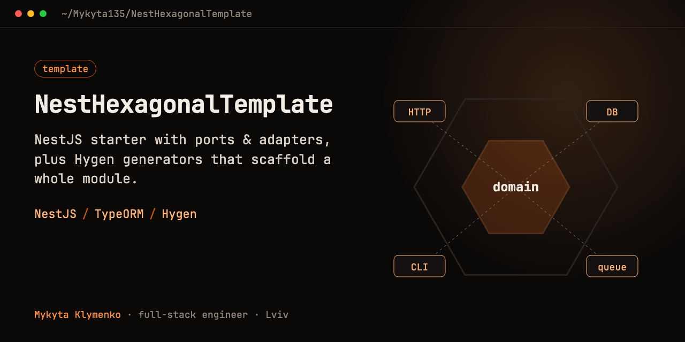

# NestHexagonalTemplate

A NestJS starter built around ports & adapters (hexagonal architecture), with [Hygen](https://www.hygen.io/) generators so a new module comes out with the same structure every time.

## Why

In a hexagonal module the business logic never imports the database or the HTTP layer. Use cases depend on a repository **port** (an interface), and the TypeORM **adapter** implements it. Swapping the database or testing a use case with an in-memory fake doesn't touch the use case itself.

Writing all those files by hand for every module is slow and easy to get inconsistent, so the generators do it.

## Structure

The `stories` module is the reference example:

```
src/stories/
├── domain/story.ts                         # domain model, no framework imports
├── application/
│   ├── ports/story.repository.ts           # the port: what use cases need from storage
│   ├── use-cases/                          # one folder per use case (+ command object)
│   │   ├── create-story/
│   │   ├── get-all/
│   │   └── get-pop/
│   ├── dto/                                # request / response DTOs
│   └── mappers/story.mapper.ts             # domain <-> DTO / entity
├── infrastructure/
│   ├── http/stories.controller.ts          # primary adapter
│   └── persistence/typeorm/                # secondary adapter: entity + repository impl
├── story.persistence.module.ts             # binds the port to the TypeORM adapter
├── story.testing.module.ts                 # binds the port to a test double
└── stories.module.ts
```

## Generators

| Command | What it does |
|---|---|
| `npm run new:module` | Scaffolds a full module: domain, port, use case, DTOs, mapper, controller, TypeORM entity and repository, persistence and testing modules |
| `npm run add:usecase` | Adds a use case with its command to an existing module |
| `npm run add:property` | Adds a field across the domain model, DTOs, entity and controller |
| `npm run add:test-suit` | Adds a test suite |

Each generator runs lint, format and a type check afterwards, so generated code compiles before you touch it.

## Run

```bash
npm install
npm run start:dev
npm test
```

## Stack

NestJS · TypeScript · TypeORM · Swagger · Hygen · Jest
